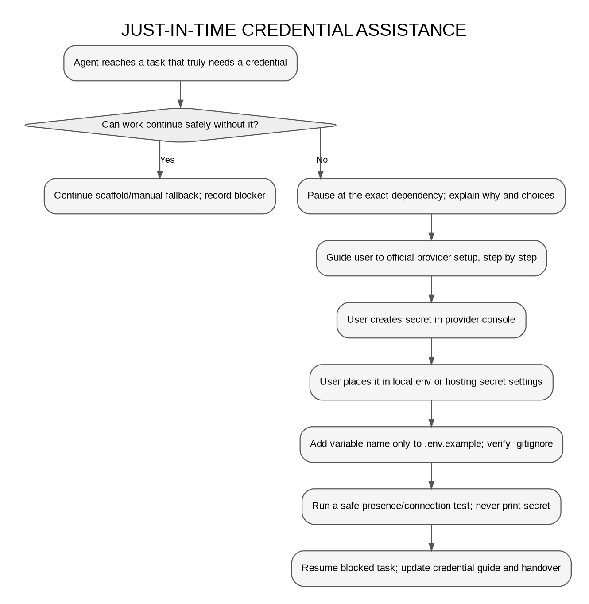

# Credentials Guide (Just in Time)

**Owns:** how credentials are requested, where each one goes and how to verify it without revealing it. **This file contains variable names and destinations only. Never values.**

## Rules for agents

1. Ask for a credential only when the **current task** cannot proceed without it. Mocks, scaffolding and manual fallbacks continue meanwhile, and only the live integration is marked `BLOCKED: credential needed`.
2. Name the service, why it's needed now and any choice the user must make.
3. Follow the provider's **official, current** documentation, opened at the time of setup. Don't rely on remembered UI steps.
4. Guide one step at a time and confirm before moving on when the next step depends on what the user sees.
5. **Never ask the user to paste a secret into the chat.** The user puts it directly into the named file or hosting secret setting.
6. State whether each variable is **public** (shipped to browsers) or **server-only**.
7. Add only the variable **name** to [.env.example](../.env.example); confirm `.gitignore` covers the real file.
8. Verify with a presence/connection check that prints only `configured` / `missing` and `pass` / `fail`.
9. Record the provider choice and variable names (not values) in [DECISIONS.md](DECISIONS.md) and the handover, then resume the task.
10. If a secret is exposed anywhere (chat, log, commit), stop using it, have the user revoke/rotate it, and check where it went.

## Credential inventory (when each is needed)

| Needed at task | Service | Variable(s) | Destination | Exposure |
|---|---|---|---|---|
| DB-1 | Supabase project URL | `SUPABASE_URL` · `NEXT_PUBLIC_SUPABASE_URL` | `backend/.env` · both `*-frontend/.env.local` | Public identifier |
| DB-1 | Supabase publishable key | `SUPABASE_PUBLISHABLE_KEY` · `NEXT_PUBLIC_SUPABASE_PUBLISHABLE_KEY` | `backend/.env` · both `*-frontend/.env.local` | Public (protected by RLS) |
| DB-1 | Supabase secret key (bypasses RLS) | `SUPABASE_SECRET_KEY` | `backend/.env` only | **Server-only** |
| DB-2 | Database migration access (CLI login or connection string; decided at DB-2) | TBD at DB-2, explained before asking | Local shell / `backend/.env` only | **Server-only** |
| DB-4 | Demo passwords for seeded accounts (**user-chosen**, at least 12 characters, never a reused real password) | `SEED_AUTHOR_PASSWORD`, `SEED_ADMIN_PASSWORD` (placeholders added to `backend/.env` 2026-10-17; at the user's request the agent **generated** random 20-character values into the file without displaying them; the user reads them from `backend/.env` when needed) | `backend/.env` (used by `npm run seed:apply` and `npm run test:rls` only) | Demo-only; published in README for evaluators |
| AI-1 | LLM keys (D-028) | `GEMINI_API_KEY` (primary), `GROQ_API_KEY` (fallback) + `AI_PRIMARY_PROVIDER=gemini`, `AI_FALLBACK_PROVIDER=groq` (models default per provider) | `backend/.env` | **Server-only** |
| AI-1 | Never a second key for the same provider | (`GROQ_FALLBACK_API_KEY` is unused and flagged by `check:ai`: key cycling, C-14) | n/a | n/a |
| DEP-1/2 | Hosting accounts (Render, Vercel) | Same names as above in each host's environment settings | Render (backend) · Vercel ×2 (frontends) | Per variable as above |

**Confirmed at DB-1 (2026-10-17, official Supabase docs):** use **publishable** (`sb_publishable_…`) and **secret** (`sb_secret_…`) keys from **Settings → API Keys** (the **Connect** dialog also shows the URL and publishable key). Legacy `anon`/`service_role` keys are deprecated and slated for removal by the end of 2026. Supabase rejects secret keys sent from a browser (401), but that's no reason to relax the rule.

## Step outlines (expanded live, from official docs, when the task arrives)

### Supabase (DB-1)
1. User creates (or picks) a Supabase project in the official dashboard and chooses a region close to India.
2. User copies the project URL and publishable key into `backend/.env` and both frontend `.env.local` files.
3. User copies the secret key into `backend/.env` **only**.
4. Agent explains: the publishable key is safe in browsers because RLS guards the data; the secret key bypasses RLS and must never leave the backend.
5. User disables email signups in the Auth settings (accounts come from the seed script).
6. Agent runs `npm run check:env`, which prints each variable as configured/missing/placeholder, the key kind, frontend↔backend matches, a "no server secrets in frontend files" check, and connection pass/fail plus "sign-ups disabled". **Completed 2026-10-17: Result OK** ([verification/2026-10-17-db1.md](verification/2026-10-17-db1.md)).

### LLM provider (AI-1)
1. Agent confirms the provider/model decision (Q-04 → D-028) and that the mock provider covers all tests.
2. User creates a key in the provider's official console (Google AI Studio, GroqCloud), with spend limits set there if available.
3. User puts it in `backend/.env` under the provider's variable (`GEMINI_API_KEY`, `GROQ_API_KEY`), and sets `AI_PRIMARY_PROVIDER` / `AI_FALLBACK_PROVIDER`.
4. Agent runs `npm run check:ai` (presence, providers and models; never values), then `npm run check:ai:live`: **one** synthetic call per model, reporting the outcome kind, latency and token counts only. **Completed 2026-10-18** ([verification/2026-10-19-ai1-ai2.md](verification/2026-10-19-ai1-ai2.md)).

### Hosting (DEP-1/2)
1. User connects the repository to Render/Vercel through the official dashboards.
2. User enters each variable in the host's environment settings. Agent provides the name list and exposure class per service, never values.
3. Agent verifies `/health` and a CORS preflight from each frontend origin.

## Safe check rules

- Print variable **names** with `configured` / `missing`, never values or lengths.
- Never log request headers, connection strings or full error bodies from auth failures.
- Smoke calls use synthetic content, not real author data.
