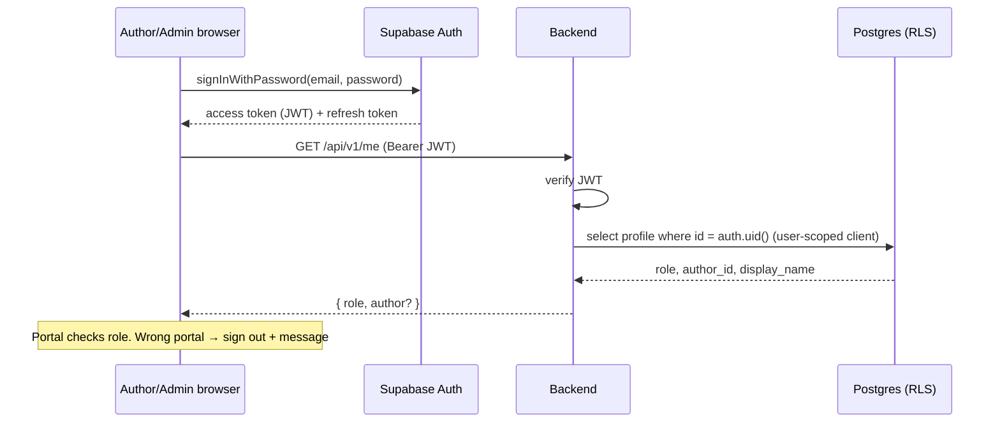
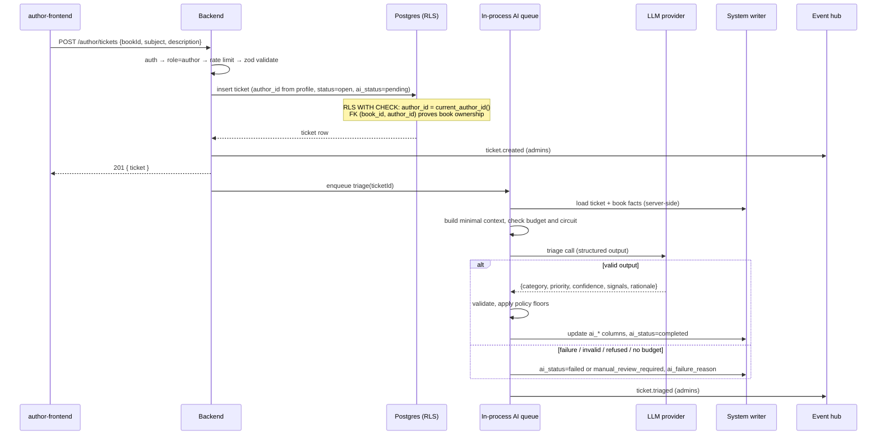
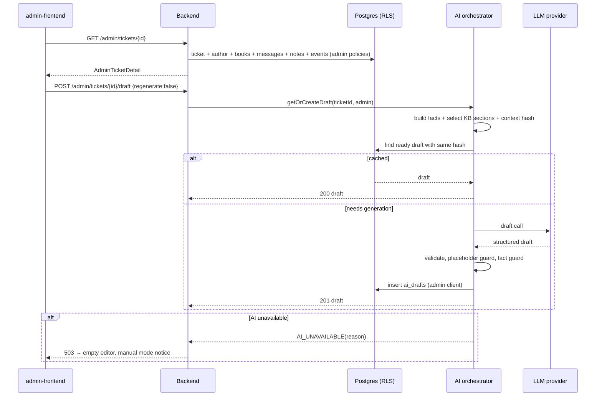
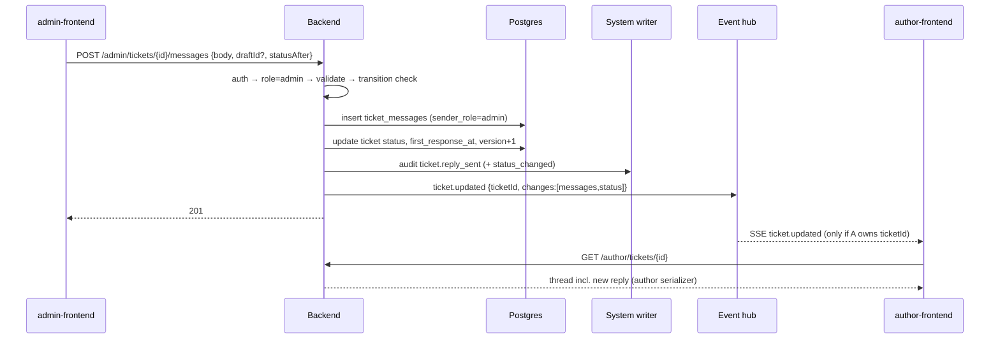

# Flow: Real Call Paths

**Owns:** how requests actually travel across UI → API → services → database → AI. **Status: planned paths.** Update this file whenever the implementation diverges.

## 1. Sign-in and session

## 2. Author creates a ticket (save first, AI second)

## 3. Admin opens a ticket and gets a draft

## 4. Admin sends a reply; author sees it live

## 5. Admin override and assignment

`PATCH /admin/tickets/{id} {version, category?, priority?, status?, assignedAdminId?}`
→ auth → role=admin → validate → load ticket → version check (409) → transition check (422) → assignment check (self or null) → update + `version+1` → `category_source/priority_source='admin'` for overrides → audit event per changed field (old/new) → `ticket.internal_updated` or `ticket.updated` (status) → 200.

## 6. Startup recovery

On boot: select tickets with `ai_status in ('pending','failed')`, `created_at < now() - 2 min` and `ai_attempts < 3` → enqueue triage. Tickets reaching 3 attempts → `manual_review_required`.
