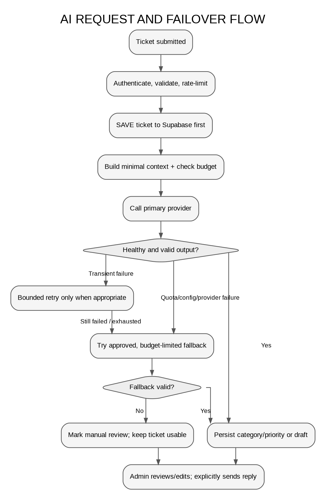

# AI Failure Handling

**Owns:** the AI failure matrix: detection, retry policy, ticket state, admin-visible behaviour and recovery. Mechanics (router, breaker, budget) are in [AI_PROVIDER_ORCHESTRATION.md](AI_PROVIDER_ORCHESTRATION.md). Core guarantee (C-10): **ticket creation and manual replies never depend on AI.**

## Failure matrix

As built (AI-2, D-028), "Detection" comes from the REST adapters' classification of HTTP status and structured fields rather than SDK exception classes. A 429 with a retry delay over 60 s is a `quota` window (the provider is parked for an hour and the fallback serves). Router-level behaviour for AF-01..AF-08 is implemented and tested in `backend/test/ai-router.test.ts`; ticket-state outcomes (`failed`, `manual_review_required`) are implemented by the triage job (AI-3, D-029) and tested in `backend/test/ai-triage.test.ts` (AF-04, AF-05, AF-07, AF-09, AF-10) and live in `test-integration/ai-triage.test.ts`. AF-11 (draft fact mismatch → draft returned with warnings) is implemented in AI-4 (`ai-drafts.test.ts`). The draft path also covers AF-04 (one repair, then 503 `invalid_output`) and AF-07 (AI off → 503 `not_configured`).

| Condition | Detection | Retry? | Fallback provider? | Breaker | Triage outcome (`ai_status` / reason) | Draft outcome | Admin sees |
|---|---|---|---|---|---|---|---|
| Temporary rate limit (429) | SDK `RateLimitError` after its retries | SDK only (bounded, honours `retry-after`) | Yes, if configured | +1 failure | `failed` / `provider_unavailable` → sweeper | 503 `provider_unavailable` | "AI is busy right now. Retry shortly or write manually." |
| Provider overloaded / 5xx | SDK `InternalServerError` / 529 | SDK only | Yes | +1 failure | `failed` → sweeper | 503 | "The AI service isn't responding." |
| Timeout | SDK timeout | SDK only | Yes | +1 failure | `failed` → sweeper | 503 | Same |
| Connection error | SDK `APIConnectionError` | SDK only | Yes | +1 failure | `failed` → sweeper | 503 | Same |
| Invalid / revoked key (401/403) | `AuthenticationError` / `PermissionDeniedError` | **No** | Yes | Forced open until config change | `manual_review_required` / `provider_unavailable` | 503 | "AI is unavailable (configuration issue)." Logs: config error, key never printed |
| Hard quota / billing limit reached at provider | 429/403 with quota semantics (adapter maps it) | **No** | Only if configured and budgeted | Forced open | `manual_review_required` | 503 | "AI is unavailable." |
| Our daily budget exhausted | `budget.exhausted()` before the call | No (resets daily) | **No** (budget is global) | n/a | `manual_review_required` / `budget_exhausted` | 503 `budget_exhausted` | "AI drafting is paused for today (budget reached)." |
| Circuit open | Breaker state | No | Yes | n/a | `failed` / `circuit_open` → sweeper after cooldown | 503 `circuit_open` | "AI is temporarily paused after repeated errors." |
| Bad request (400) | `BadRequestError` | No | No (same request) | No | `manual_review_required` / `provider_unavailable`; logged as a bug | 503 | "AI couldn't process this ticket." |
| Refusal (`stop_reason: refusal`) | Adapter | No | No | No | `manual_review_required` / `refused` | 503 `refused` | "AI declined to process this ticket. Please handle manually." |
| Malformed / schema-invalid output, or `max_tokens` cut-off | zod / semantic validation | One repair attempt | No | No | `manual_review_required` / `invalid_output` | 503 `invalid_output` | "AI produced an unusable result." |
| Draft with fact mismatches | Fact guard | No | n/a | n/a | n/a | **Draft returned** with `factWarnings` | Warning list above the editor |
| AI disabled (`AI_PRIMARY_PROVIDER=none`) | Config | n/a | n/a | n/a | `manual_review_required` / `not_configured` immediately | 503 `not_configured` | "AI is turned off. Triage and reply manually." |
| Backend restart mid-job | Ticket left `pending` | Sweeper (≤ 2 more attempts) | n/a | n/a | Eventually `completed` or `manual_review_required` | n/a | "Triaging…" until resolved |
| Recovery after outage | Breaker half-open probe succeeds | Sweeper re-queues eligible tickets | n/a | Closes | Pending work completes; **no messages are ever sent automatically** | Admin requests drafts as needed | Normal |

## Rules

1. **One retry layer.** SDK retries handle transient errors. The router never loops. The sweeper retries whole jobs at most twice, minutes apart.
2. **Never retry auth/quota/bad-request.** It can't succeed and wastes budget.
3. **Never cycle keys** to get around limits (C-14).
4. **Never block the human path.** Every failure leaves the ticket editable and replyable.
5. **Never leak provider internals.** Clients get a reason code from a fixed list. Logs get the error kind and requestId, not the key or the prompt.
6. **Overrides are sacred.** Recovery never overwrites admin-set category/priority.

## Tests (mock provider, AI-2/AI-3/AI-4)

| ID | Simulated failure | Assert |
|---|---|---|
| AF-01 | Primary returns 429 | Ticket `failed`; usage event `rate_limited`; breaker count +1 |
| AF-02 | 3 consecutive timeouts | Breaker open; next call skipped with `circuit_open`; probe after cooldown |
| AF-03 | 401 | No retry; breaker forced open; log has no key material |
| AF-04 | Invalid JSON / invalid enum | One repair attempt, then `manual_review_required/invalid_output`; nothing persisted to category |
| AF-05 | Refusal | `manual_review_required/refused`; no failover |
| AF-06 | Budget at limit | No provider call made; `budget_blocked` usage event |
| AF-07 | Provider `none` | Ticket create 201; `manual_review_required/not_configured` |
| AF-08 | Fallback configured, primary 5xx | Fallback used; usage events for both |
| AF-09 | Restart with pending ticket | Sweeper triages it; attempts increment; capped at 3 |
| AF-10 | Admin override then late triage result | Effective values unchanged; AI columns updated |
| AF-11 | Draft fact mismatch | Draft returned with warnings |
