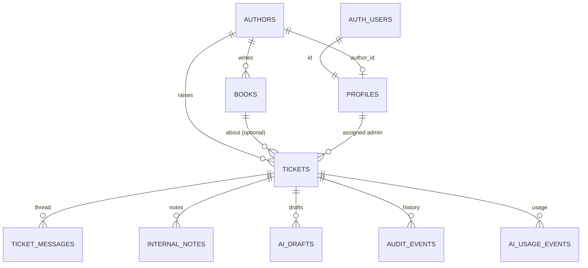

# Data Model

**Owns:** tables, columns, enums, constraints, indexes and triggers (Supabase Postgres). Access policies are in [SUPABASE_RLS.md](SUPABASE_RLS.md); reasoning about sensitivity is in [.agent/DATA.md](../.agent/DATA.md).

**Status:** applied to the Supabase project on 2026-10-17 (see the migration log below): [supabase/migrations/20261017090000_initial_schema.sql](../supabase/migrations/20261017090000_initial_schema.sql). Rollback (destructive): [supabase/rollback/20261017090000_initial_schema_down.sql](../supabase/rollback/20261017090000_initial_schema_down.sql). Enum values are kept in step with `packages/shared` and `openapi.yaml` by `backend/test/schema-contract.test.ts`.

## ER overview



## Enums

| Enum | Values |
|---|---|
| `user_role` | `author`, `admin` |
| `ticket_status` | `open`, `in_progress`, `resolved`, `closed` |
| `ticket_category` | `royalty_payments`, `isbn_metadata`, `printing_quality`, `distribution_availability`, `book_status_production`, `general_inquiry` |
| `ticket_priority` | `critical`, `high`, `medium`, `low` |
| `ai_status` | `pending`, `completed`, `failed`, `manual_review_required` |
| `value_source` | `ai`, `admin` |
| `message_sender` | `author`, `admin` |
| `draft_status` | `ready`, `superseded` |

## Tables

### `authors` (seeded, read-only in app)

| Column | Type | Constraints |
|---|---|---|
| `author_id` | text | PK, `check (author_id ~ '^AUTH[0-9]{3,}$')` |
| `name` | text | not null |
| `email` | text | not null; unique index on `lower(email)` |
| `phone` | text | null |
| `city` | text | null |
| `joined_date` | date | not null |
| `created_at` | timestamptz | not null default `now()` |

### `books` (seeded, read-only in app)

| Column | Type | Constraints |
|---|---|---|
| `book_id` | text | PK |
| `author_id` | text | not null → `authors` (on delete restrict) |
| `title` | text | not null |
| `isbn` | text | not null, unique. Stored as given; **no checksum validation** (placeholders) |
| `genre` | text | not null |
| `publication_date` | date | null (in production) |
| `status` | text | not null; `check (status = 'Published & Live' or status = 'Manuscript Received' or status ~ '^In Production - .+$')` |
| `mrp` | numeric(10,2) | null; `>= 0` |
| `author_royalty_per_copy` | numeric(10,2) | null; `>= 0` |
| `total_copies_sold` | integer | not null default 0; `>= 0` |
| `total_royalty_earned` | numeric(12,2) | not null default 0 |
| `royalty_paid` | numeric(12,2) | not null default 0; `>= 0` |
| `royalty_pending` | numeric(12,2) | not null default 0; `>= 0` |
| `last_royalty_payout_date` | date | null |
| `print_partner` | text | null |
| `available_on` | text[] | not null default `'{}'` |
| `created_at` | timestamptz | not null default `now()` |

Table constraints: `unique (book_id, author_id)` (target of the tickets composite FK); `check (royalty_paid + royalty_pending = total_royalty_earned)`.

### `profiles` (one per auth user)

| Column | Type | Constraints |
|---|---|---|
| `id` | uuid | PK → `auth.users(id)` on delete cascade |
| `role` | user_role | not null |
| `author_id` | text | null, unique → `authors` |
| `display_name` | text | not null |
| `created_at` | timestamptz | not null default `now()` |

`check ((role = 'author' and author_id is not null) or (role = 'admin' and author_id is null))`

### `tickets`

| Column | Type | Constraints / notes |
|---|---|---|
| `id` | uuid | PK default `gen_random_uuid()` |
| `reference_no` | bigint | `generated always as identity (start with 1001)`, unique |
| `reference` | text | `generated always as ('BL-' || reference_no) stored` |
| `author_id` | text | not null → `authors` |
| `book_id` | text | null (= General / Account Level) |
| | | **FK `(book_id, author_id)` → `books(book_id, author_id)`**: a ticket's book must belong to its author (not checked when `book_id` is null) |
| `subject` | text | not null, `char_length` 5–150 |
| `description` | text | not null, `char_length` 20–5000 |
| `attachment_name` | text | null, ≤ 255 |
| `status` | ticket_status | not null default `open` |
| `category` / `category_source` | ticket_category / value_source | null; `check ((category is null) = (category_source is null))` |
| `priority` / `priority_source` | ticket_priority / value_source | null; same pairing check |
| `ai_status` | ai_status | not null default `pending` |
| `ai_category` | ticket_category | null (raw AI suggestion, kept after override) |
| `ai_priority` | ticket_priority | null (after policy floor) |
| `ai_confidence` | numeric(3,2) | null, 0–1 |
| `ai_signals` | text[] | not null default `'{}'` |
| `ai_rationale` | text | null, ≤ 300 |
| `ai_policy_floor` | text | null (rule name) |
| `ai_attempts` | smallint | not null default 0 |
| `ai_failure_reason` | text | null (`not_configured`, `provider_unavailable`, `circuit_open`, `budget_exhausted`, `invalid_output`, `refused`) |
| `ai_prompt_version` | text | null |
| `ai_processed_at` | timestamptz | null |
| `assigned_admin_id` | uuid | null → `profiles(id)` |
| `version` | integer | not null default 1 |
| `created_at` / `updated_at` | timestamptz | not null default `now()` |
| `first_response_at` / `resolved_at` / `closed_at` | timestamptz | null |
| `urgency_rank` | smallint | not null, `generated always as (…) stored`: unresolved 0–4 / resolved+closed 10–14 by priority (critical, high, untriaged, medium, low). Queue sort key (D-025) |

### `ticket_messages` (author-visible thread, append-only)

| Column | Type | Constraints |
|---|---|---|
| `id` | uuid | PK |
| `ticket_id` | uuid | not null → `tickets` on delete cascade |
| `sender_role` | message_sender | not null |
| `sender_profile_id` | uuid | not null → `profiles` |
| `body` | text | not null, 1–5000 |
| `ai_draft_id` | uuid | null → `ai_drafts` (which draft it came from) |
| `created_at` | timestamptz | not null default `now()` |

The original description lives on `tickets`, not as a message.

### `internal_notes` (admin-only, append-only)

`id` uuid PK · `ticket_id` → tickets · `admin_profile_id` → profiles · `body` text 1–5000 · `created_at`.

### `ai_drafts`

| Column | Type | Notes |
|---|---|---|
| `id` | uuid | PK |
| `ticket_id` | uuid | → tickets |
| `status` | draft_status | default `ready`; older drafts become `superseded` |
| `reply` | text | |
| `kb_sections_used` | text[] | |
| `needs_escalation` | boolean | |
| `escalation_team` | text | |
| `internal_checklist` / `missing_information` / `fact_warnings` | text[] | |
| `context_hash` | text | not null |
| `prompt_version` / `provider` / `model` | text | |
| `input_tokens` / `output_tokens` | integer | |
| `requested_by` | uuid | → profiles |
| `created_at` | timestamptz | |

### `audit_events` (append-only)

`id` uuid PK · `ticket_id` uuid null · `actor_profile_id` uuid null (null = system/AI) · `action` text not null (`ticket.created`, `ticket.triaged`, `ticket.status_changed`, `ticket.category_overridden`, `ticket.priority_overridden`, `ticket.assigned`, `ticket.unassigned`, `ticket.reply_sent`, `ticket.note_added`, `ticket.triage_requested`, `ai.draft_generated`, `ai.draft_regenerated`) · `metadata` jsonb not null default `'{}'` (old/new values, IDs; **never message bodies**) · `created_at` (the system writer stamps batched events 1 ms apart so they keep their order; D-026).

### `ai_usage_events` (append-only)

`id` · `ticket_id` null · `task` (`triage`, `draft`) · `provider` · `model` · `prompt_version` · `outcome` (`success`, `invalid_output`, `refused`, `timeout`, `rate_limited`, `provider_error`, `auth_error`, `budget_blocked`, `circuit_open`, `not_configured`) · `input_tokens` · `output_tokens` · `cache_read_tokens` · `cache_write_tokens` · `latency_ms` · `estimated_cost_usd` numeric(10,6) · `created_at`.

## Indexes

| Table | Index | Serves |
|---|---|---|
| tickets | `(author_id, updated_at desc)` | Author's ticket list |
| tickets | `(author_id, created_at desc)` | Rate-limit trigger |
| tickets | `(book_id)` | Composite FK lookups |
| tickets | `(status, priority, created_at)` | Status / priority filters |
| tickets | `(urgency_rank, created_at)` | Queue urgency sort (API-5) |
| tickets | `(assigned_admin_id)` | "Assigned to me" |
| tickets | partial `(created_at) where ai_status in ('pending','failed')` | Sweeper |
| ticket_messages | `(ticket_id, created_at)` | Thread |
| internal_notes | `(ticket_id, created_at)` | Notes |
| ai_drafts | `(ticket_id, created_at desc)` | Latest draft per ticket |
| ai_drafts | partial `(ticket_id, context_hash) where status = 'ready'` | Draft reuse |
| audit_events | `(ticket_id, created_at)` | Timeline |
| ai_usage_events | `(created_at)` | Daily budget sum |
| books | `(author_id)` | My Books |

## Triggers

| Trigger | Table | Behaviour |
|---|---|---|
| `set_updated_at_and_version` | tickets | `before update`: `updated_at = now()`, `version = old.version + 1` |
| `tickets_immutable_fields` | tickets | `before update`: reject changes to `author_id`, `book_id`, `subject`, `description`, `attachment_name`, `created_at`, `reference_no` |
| `tickets_author_rate_limit` | tickets | `before insert`: if the author has ≥ 5 tickets in the last 10 minutes or ≥ 20 in the last 24 hours, raise `P0001 'rate_limited'` (backstop for direct API calls; see SUPABASE_RLS §4). Runs as the inserting user, so under RLS it counts only that author's tickets |
| `ticket_messages_touch_ticket` | ticket_messages | `after insert`: bump the parent ticket's `updated_at` (and so its `version`). `security definer` with `search_path = ''`, because authors may add follow-ups but cannot update tickets under RLS |

All trigger functions set `search_path = ''` and schema-qualify every name.

## Functions (called by the API)

| Function | Behaviour |
|---|---|
| `admin_send_reply(p_ticket_id, p_body, p_status_after = 'in_progress', p_draft_id = null)` | Admin reply in one transaction: lock the ticket, refuse unless open/in progress, insert the message as `auth.uid()`, set `first_response_at` if null, set the status and `resolved_at`. Returns `message_id, message_created_at, previous_status, new_status, first_response`. `security invoker`, `search_path = ''`; `EXECUTE` for `authenticated` only (D-027) |

## Lock-down at creation

The migration enables RLS on **every** table with **no** policies, and revokes all table, sequence and function grants from `anon`. Until the DB-3 policies exist, client roles see nothing. Only the backend's secret key (system writer, seed) can read or write.

## Migration log

Migrations are applied by the user through the Supabase dashboard **SQL Editor** (D-021), so Supabase keeps no migration history of its own. This table is the record. The files in `supabase/migrations/` are the source of truth and are applied in filename order, each exactly once.

| Migration | Applied | Method | Verified by |
|---|---|---|---|
| `20261017090000_initial_schema.sql` | 2026-10-17 | SQL Editor (user) | `npm run check:db`: 9/9 tables, anon denied, royalty check enforced ([verification](../.agent/verification/2026-10-17-db2.md)) |
| `20261017120000_rls_policies.sql` | 2026-10-18 | SQL Editor (user), third attempt (see verification) | `check:db` access probes yes/yes; `npm run test:rls` 15/15 ([verification](../.agent/verification/2026-10-18-db3-db4.md)) |
| `20261018090000_queue_urgency_rank.sql` | 2026-10-18 | SQL Editor (user) | Fingerprint `10 · 12 · 16 · false · 1`; `check:db` `urgency_rank` present; live queue suite 7/7 ([verification](../.agent/verification/2026-10-18-api5.md)) |
| `20261018120000_admin_reply_function.sql` | 2026-10-18 | SQL Editor (user) | Fingerprint `10 · 12 · 16 · false · 1 · 1`; `check:db` `admin_send_reply` present and refuses non-admins; live reply suite 7/7 ([verification](../.agent/verification/2026-10-18-api7.md)) |

**Before and after every migration**, run this fingerprint query in the SQL Editor tab you're using. It confirms the tab is the app's database (`authors 10 · logins 12` once seeded) and shows the policy state:

```sql
select (select count(*) from public.authors) as authors,
       (select count(*) from auth.users) as logins,
       (select count(*) from pg_policies where schemaname = 'public') as policies,
       has_table_privilege('authenticated', 'public.books', 'UPDATE') as clients_can_edit_books;
```

Then run `npm run check:db`, which signs in as a seeded author and confirms the rules are live from the app's side.

## Money and dates

- Money as `numeric` in rupees (source values are whole rupees); the API returns JSON numbers. No floating-point arithmetic in the backend: sums are done in SQL or with integer rupees.
- Dates without time (`publication_date`, `joined_date`, payout dates) are `date`. Events are `timestamptz` (UTC).
