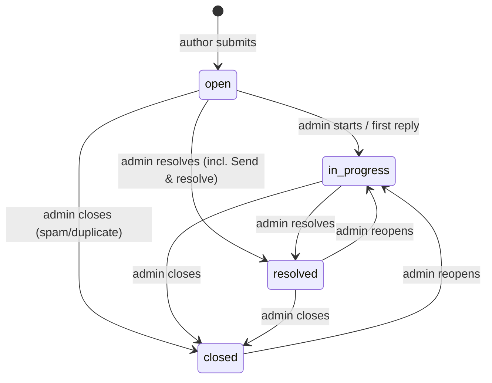

# Ticket Lifecycle

**Owns:** the status machine, who can trigger each transition, side effects and first-response targets. AI processing state (`ai_status`) is separate from ticket status and is described in [AI_SPEC.md](../AI_SPEC.md).

## 1. Status machine

Authors never change status (A-17). Any transition not drawn returns `422 INVALID_STATUS_TRANSITION`. A requested status equal to the current one is not a change: nothing is written or audited (D-026). The machine lives in `packages/shared/src/ticket-lifecycle.ts`, so the admin portal can enable only allowed transitions.

## 2. Side effects

| Event | Effects |
|---|---|
| Ticket created | `status=open`, `ai_status=pending`; audit `ticket.created`; event `ticket.created`; triage enqueued |
| AI triage completes | AI columns set; effective `category`/`priority` set **unless an admin set them** (`*_source = 'admin'`; D-029); audit `ticket.triaged` (actor null); event `ticket.triaged` (API-8) |
| Admin re-runs AI triage | `ai_status` back to `pending` with fresh attempts, then triaged in the background; audit `ticket.triage_requested`; at most 3 per ticket per day |
| Admin overrides category/priority | Effective value + `*_source='admin'`; AI columns untouched; audit `*_overridden` with old/new; event `ticket.internal_updated` |
| Admin sends reply | One transaction (`admin_send_reply`, D-027): message inserted; `first_response_at` set if null; status → `statusAfter` (default `in_progress`; from `open` or `in_progress` only; `resolved`/`closed` must be reopened first, else 422); `resolved_at` stamped when resolving. Then audit `ticket.reply_sent` (+ `ticket.status_changed` with `via: "reply"`); event `ticket.updated` (API-8) |
| → resolved | `resolved_at = now()` |
| → closed | `closed_at = now()` |
| Reopen (→ in_progress from resolved/closed) | `resolved_at`, `closed_at` set null (history stays in audit) |
| Assign / unassign self | `assigned_admin_id` = caller (only when unassigned) / null (only when the caller is the assignee), otherwise 422 `INVALID_ASSIGNMENT`; no status change; audit `ticket.assigned` / `ticket.unassigned`; event `ticket.internal_updated` |
| Internal note | Note inserted; audit `ticket.note_added` (no body in metadata); event `ticket.internal_updated` |
| Author follow-up (P2) | Allowed on `open`/`in_progress`; message inserted; event `ticket.updated` |

Every admin mutation of the ticket row checks `version` (optimistic locking) and increments it (trigger).

## 3. First-response targets (internal, assumption A-08)

| Priority | Target from `created_at` |
|---|---|
| Critical | 4 hours |
| High | 24 hours |
| Untriaged | 24 hours (treated as High until triaged) |
| Medium | 48 hours |
| Low | 72 hours |

`slaState` (computed in the API, not stored):

| State | Rule |
|---|---|
| `met` | `first_response_at` ≤ `created_at` + target |
| `breached` | No first response and now > `created_at` + target, or first response after target |
| `due_soon` | No first response and remaining time < 25% of target |
| `on_track` | Otherwise, with no first response yet |
| `not_applicable` | Resolved or closed without any response (spam, duplicates, resolved without a reply; D-025) |

**Overdue** (the summary's `slaBreached` and the queue's `overdue=true`) is the actionable part of `breached`: unresolved, no first response, past the target. A ticket whose first reply came late still shows `breached`, but is no longer overdue.

The rules live in `packages/shared/src/sla.ts` (D-025). These are internal operational targets, never promised to authors.

## 4. Queue urgency ordering (`sort=urgency`)

1. Unresolved (`open`, `in_progress`) before resolved/closed.
2. Priority rank: critical (0), high (1), untriaged (2), medium (3), low (4).
3. `created_at` ascending (oldest first).

Implemented as the generated column `tickets.urgency_rank` (migration `20261018090000_queue_urgency_rank.sql`, D-025), because the Data API can only order by columns. The queue orders by `urgency_rank`, `created_at`, then `id`, so pagination stays stable.
