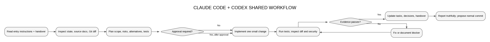

# AI Workflow: How Coding Agents Work on This Repository

**Owns:** the session procedure for Claude Code and Codex (development AI), including review gates and handover. Runtime AI inside the product is a separate topic owned by [AI_SPEC.md](AI_SPEC.md). Git rules are owned by [GIT_WORKFLOW.md](GIT_WORKFLOW.md) and are not repeated here.

Entry points: Claude Code reads [CLAUDE.md](CLAUDE.md); Codex reads [AGENTS.md](AGENTS.md). Both are short pointers to this file. **One workflow, two entry points.**

## 1. Session start (every time)

1. Read [PROJECT_STATE.md](PROJECT_STATE.md), [TASKS.md](TASKS.md), [.agent/HANDOVER.md](.agent/HANDOVER.md) and [GIT_WORKFLOW.md](GIT_WORKFLOW.md).
2. Read [.agent/CONSTRAINTS.md](.agent/CONSTRAINTS.md). These rules are non-negotiable.
3. Read only the documents relevant to the task. [DOCUMENTATION_MAP.md](DOCUMENTATION_MAP.md) says which.
4. Inspect reality: current branch, `git status`, recent commits, uncommitted diffs, and the actual files and tests you will touch.
5. If another agent's uncommitted work touches the same files, stop and ask.

## 2. Plan before editing

State, briefly:

- The task ID from `TASKS.md` and its acceptance criteria.
- Files to change, alternatives considered and why this one.
- Risks (auth, RLS, secrets, data, cost) and how they are checked.
- Tests that will prove it.
- Any credential or external dependency, handled **just in time** per [.agent/CREDENTIALS_GUIDE.md](.agent/CREDENTIALS_GUIDE.md).

## 3. Approval gates

Ask the user and wait for an explicit yes before:

- Installing or upgrading packages, plugins or CLIs.
- Creating external accounts/projects, changing provider configuration or spending money (including live LLM eval runs).
- Database migrations against a shared/hosted database, and anything destructive.
- Changing authentication, authorization, RLS or the secrets boundary.
- Committing (unless authorised for the task), pushing, merging, deploying.

Silence is not approval. Approval for one action does not carry over to the next.

## 4. Implement

- One bounded task or vertical slice at a time.
- Follow the canonical contract ([openapi.yaml](openapi.yaml)) and specs. Change the spec first if the contract must change.
- Match existing code style; keep modules small (router → service → repository).
- Never hardcode secrets, never weaken an authorization check to make a test pass, never delete or skip tests to go green.

## 5. Verify

- Run the relevant checks that exist: typecheck, lint, unit/integration tests, build, and the security checks in [.agent/SECURITY_REVIEW_CHECKLIST.md](.agent/SECURITY_REVIEW_CHECKLIST.md) for auth/data changes.
- For UI changes, view the change in a browser at the viewports listed in [.front/ACCESSIBILITY_RESPONSIVENESS.md](.front/ACCESSIBILITY_RESPONSIVENESS.md) that matter for it.
- Record real command outputs (summarised) in `.agent/verification/`. **A check that was not run is reported as "not run", never as passed.**
- Read the full diff: authorization, RLS, secrets, dependencies, network calls, removed tests, unrelated files.

## 6. Update state and hand over

Before ending a session:

1. Update the task status and evidence in [TASKS.md](TASKS.md).
2. Record material decisions in [.agent/DECISIONS.md](.agent/DECISIONS.md) (alternatives in [.agent/ALTERNATIVES.md](.agent/ALTERNATIVES.md)).
3. Update [.agent/FLOW.md](.agent/FLOW.md), [.agent/THREAT_MODEL.md](.agent/THREAT_MODEL.md) or [.agent/FAILURE.md](.agent/FAILURE.md) if the change affects them.
4. Update [PROJECT_STATE.md](PROJECT_STATE.md) (milestone, verified facts, blockers).
5. Rewrite [.agent/HANDOVER.md](.agent/HANDOVER.md): done, in progress, broken/risky, next, do-not-touch.
6. Propose a commit message per [GIT_WORKFLOW.md](GIT_WORKFLOW.md). A proposed commit is not a commit.

## 7. Truthfulness rules

- Never claim a file was read, a test passed, a deployment exists or a credential is configured unless it actually happened in this session or is recorded with evidence.
- Never invent commit hashes, URLs, keys or test output.
- When documentation and code disagree, report the discrepancy. Don't silently pick one.

## 8. Templates

- New feature: [.agent/templates/FEATURE_TEMPLATE.md](.agent/templates/FEATURE_TEMPLATE.md)
- Bug: [.agent/templates/BUG_TEMPLATE.md](.agent/templates/BUG_TEMPLATE.md)
