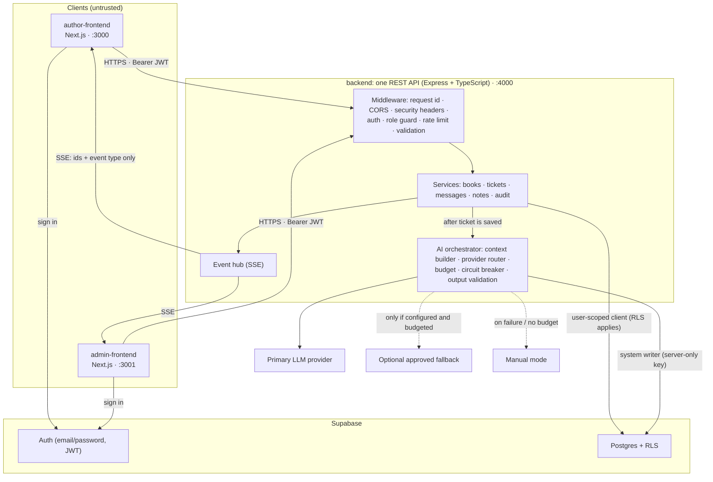

# Architecture

**Owns:** the system map, runtime components, service boundaries and trust boundaries. Decisions and their alternatives are in [.agent/DECISIONS.md](.agent/DECISIONS.md) and [.agent/ALTERNATIVES.md](.agent/ALTERNATIVES.md). Request-level call paths are in [.agent/FLOW.md](.agent/FLOW.md).

**Status:** Planned. Nothing below is implemented yet.

## 1. System shape

Two frontend experiences, one backend, one database platform, and an AI boundary inside the backend.



The blueprint's rendered version of the same shape: [docs/blueprint/BOOKLEAF_BLUEPRINT_ASSETS/architecture.png](docs/blueprint/BOOKLEAF_BLUEPRINT_ASSETS/architecture.png).

## 2. Runtime components

| Component | Responsibility | Must never |
|---|---|---|
| **author-frontend** | Sign-in, My Books, Submit a Query, My Tickets; subscribes to ticket events | Hold privileged/LLM keys; enforce security by itself (route guards are UX only) |
| **admin-frontend** | Sign-in, queue, ticket detail, overrides, draft editing, send, notes, assignment | Same as above; it is a separate bundle, so admin code is never shipped to authors |
| **backend** | All business rules, validation, authorization, ticket lifecycle, AI orchestration, audit, events, OpenAPI docs | Trust client-supplied identity/role/owner IDs; return stack traces in production |
| **Supabase Auth** | Credential check, session/JWT issuance and refresh | Allow self-signup (disabled) |
| **Supabase Postgres** | System of record; RLS policies as defense in depth | Be reachable from browsers for application data (the frontends use Supabase only for auth) |
| **AI orchestrator** (backend module) | Build minimal context, call providers within budget, validate output, persist results, degrade to manual | Decide what data a caller may see; send replies; execute model output |
| **packages/shared** | Enums, labels, zod schemas, DTO types shared by backend and frontends | Contain secrets or server-only logic |
| **packages/ui** | Monochrome tokens and accessible primitives | Contain business logic |

## 3. Trust boundaries

1. **Browser → backend.** All input is untrusted. The backend verifies the Supabase JWT, loads the caller's profile (role, `author_id`) from the database, and applies a role guard per route namespace (`/author/*`, `/admin/*`). Ownership is enforced in every query. A resource owned by someone else returns `404`, not `403`, so IDs cannot be probed.
2. **Backend → Postgres (user-scoped).** For user-initiated reads and writes the backend uses a request-scoped Supabase client carrying the caller's JWT, so **RLS applies even if a backend check is wrong**. This is the defense-in-depth layer.
3. **Backend → Postgres (system writer).** A small, separately reviewed module uses the server-only secret key (which bypasses RLS) for background work that has no user JWT: reading the one ticket (and its book) being triaged, persisting AI triage results, and appending audit and AI usage events. It exposes only narrow typed functions, and only the AI and audit modules may import it. Justification and review rules: [.back/AUTH_SECURITY.md](.back/AUTH_SECURITY.md) §5.
4. **Backend → LLM provider.** The provider is an external processor. It receives only the minimum context for the task, built *after* authorization: the ticket text, the ticket author's own relevant book facts and the relevant Knowledge Base sections. It never receives emails, phone numbers, other authors' data or internal notes. Model output is data. It is validated against a schema and can never trigger privileged actions.
5. **Backend → browser (events).** Server-Sent Events carry only `{type, ticketId}`. Clients re-fetch through the authorized REST endpoints, so event delivery cannot leak content.

## 4. Data access pattern

| Operation type | Client used | RLS enforced? | Example |
|---|---|---|---|
| Author reads/writes | Request-scoped (caller JWT) | Yes | List my books, create my ticket |
| Admin reads/writes | Request-scoped (caller JWT) | Yes (admin policies) | Change status, add note, send reply |
| Background AI triage (read ticket + book, write result) | System writer (secret key) | No: backend validates input and target row | Set AI category/priority on a ticket |
| Audit / AI usage logging | System writer | No: append-only tables, no update/delete paths | `ticket.priority_overridden` |
| Seeding | Seed script with secret key, run locally | No | Create auth users, load JSON |

Schema, constraints and policies: [.back/DATA_MODEL.md](.back/DATA_MODEL.md) and [.back/SUPABASE_RLS.md](.back/SUPABASE_RLS.md).

## 5. Ticket lifecycle and AI placement

1. Author submits a ticket. The backend validates it and **saves it first** (`status=open`, `ai_status=pending`), then responds `201`.
2. The backend enqueues triage in-process. One structured AI call returns category, priority, confidence, signals and rationale. The output is validated, deterministic policy floors are applied, and the result is persisted by the system writer. The admin queue receives an event.
3. If triage fails, the ticket is marked `manual_review_required` and stays fully usable. A startup sweeper re-queues tickets left `pending` after a restart.
4. An admin opens the ticket. The draft endpoint returns a cached draft if the ticket context is unchanged, otherwise it generates one. Generation is lazy, not on every page load.
5. The admin edits and presses Send. The reply is stored as an author-visible message, the status transition is applied, and the author is notified over SSE.

Full state machine: [.back/TICKET_LIFECYCLE.md](.back/TICKET_LIFECYCLE.md). AI details: [AI_SPEC.md](AI_SPEC.md).

## 6. Real-time updates

- `GET /api/v1/events` is a Server-Sent Events stream read with `fetch` streaming, so the bearer token travels in the `Authorization` header and never in a URL.
- An in-process event hub publishes after successful writes. Authors receive events only for their own tickets; admins receive all ticket events.
- Clients invalidate their cached queries on an event and re-fetch. If the stream drops they poll every 15 seconds until it reconnects, and they also re-fetch on window focus.
- **Known limitation:** the in-process hub assumes one backend instance. Scaling out would need Postgres `LISTEN/NOTIFY`, Supabase Realtime broadcast or Redis pub/sub (recorded in [.agent/ALTERNATIVES.md](.agent/ALTERNATIVES.md)).

## 7. Source layout (planned)

```text
BookLeaf/
├── author-frontend/        Next.js app (author experience)
├── admin-frontend/         Next.js app (admin experience)
├── backend/                Express + TypeScript API
│   └── src/
│       ├── app.ts          middleware wiring, routers, error handler
│       ├── config/         env parsing and validation (fails fast on missing vars)
│       ├── middleware/     auth, role guard, rate limits, validation, request id
│       ├── modules/        books/, tickets/, messages/, notes/, events/ (router → service → repository)
│       ├── ai/             orchestrator, providers/, prompts/, knowledge-base/, facts/, validation/
│       ├── db/             request-scoped client factory, system writer
│       └── lib/            errors, logger, clock
├── packages/shared/        enums, labels, zod schemas, DTO types
├── packages/ui/            tokens + primitives
├── supabase/
│   ├── migrations/         schema + RLS SQL
│   └── seed/               bookleaf_sample_data.json + seed script
└── docs/blueprint/         source planning bundle
```

npm workspaces tie these together. Backend layering and conventions: [.back/API_IMPLEMENTATION.md](.back/API_IMPLEMENTATION.md). Frontend structure: [.front/FRONTEND_ARCHITECTURE.md](.front/FRONTEND_ARCHITECTURE.md).

## 8. Deployment topology (planned)

| Piece | Host | Notes |
|---|---|---|
| author-frontend | Vercel project 1 (root directory `author-frontend`) | Public env only |
| admin-frontend | Vercel project 2 (root directory `admin-frontend`) | Public env only |
| backend | Render web service | All server secrets; CORS allowlist = the two Vercel origins |
| Database + Auth | Supabase cloud project | Migrations applied before deploy; signups disabled |

Steps, environment matrix and rollback: [.back/DEPLOYMENT.md](.back/DEPLOYMENT.md) and [.agent/ROLLBACK.md](.agent/ROLLBACK.md).

## 9. Technology choices (summary)

| Layer | Choice | Why (short) |
|---|---|---|
| Language | TypeScript everywhere | One language, shared contract types |
| Frontends | Next.js (App Router) ×2, TanStack Query | Matches blueprint's two-experience split; Vercel-native; query cache makes SSE invalidation trivial |
| Backend | Express 5 + zod + pino + helmet | Explicit middleware order is easy to explain line by line; async error handling built in |
| DB/Auth | Supabase Postgres + Auth | Project decision; RLS gives a second authorization layer |
| AI | Provider-agnostic interface; proposed primary Anthropic Claude Haiku 5.5 (pending confirmation) | Cheap, fast, structured outputs; see [AI_SPEC.md](AI_SPEC.md) section 2 |
| Real-time | SSE + polling fallback | One-directional updates are all that is needed; simpler than WebSockets |
| Tests | Vitest, Supertest, Playwright (smoke) | Fast unit/integration tests plus a cross-portal smoke path |
